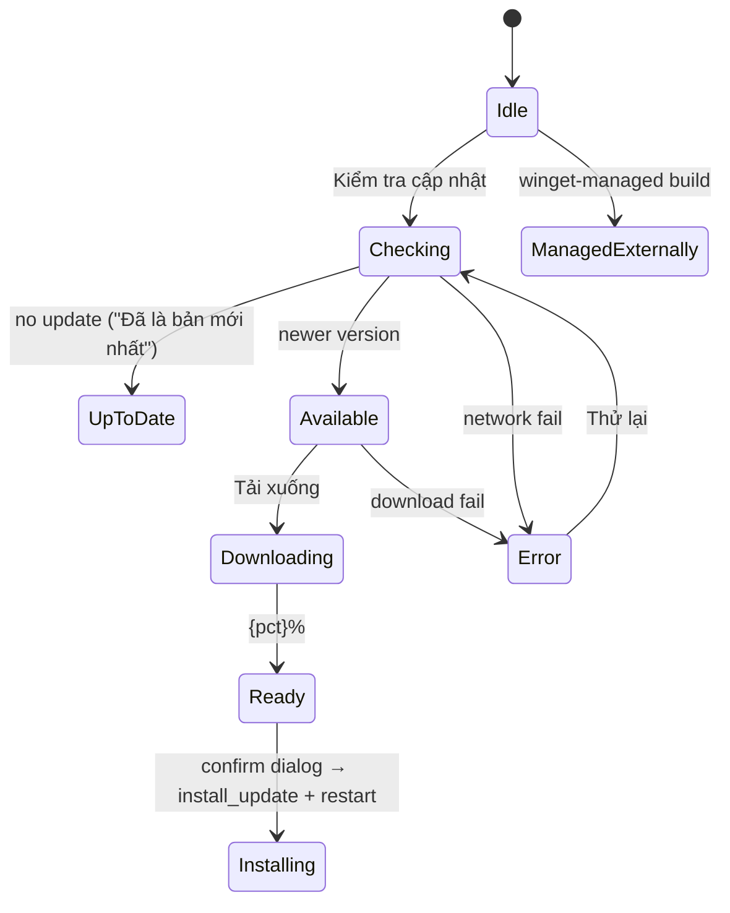
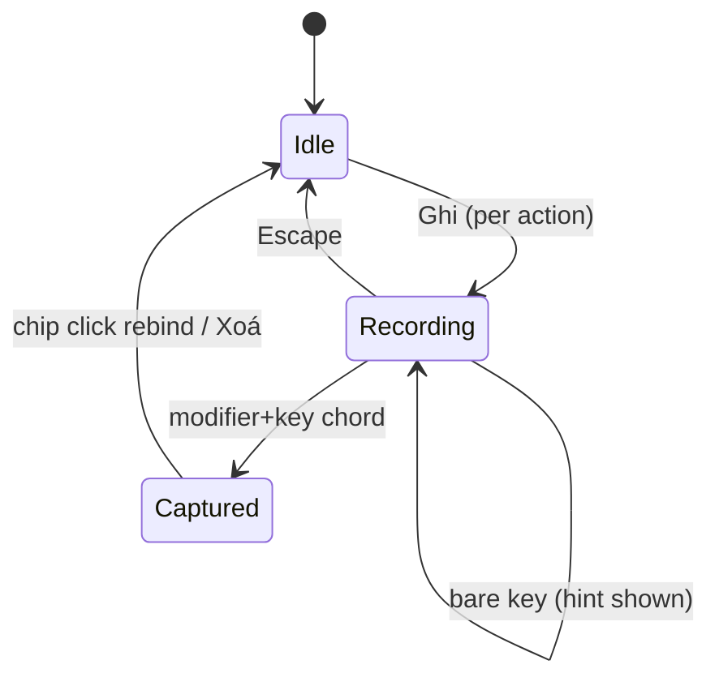

# Legacy App (v0.1.11) Design Specification — Cutover Blueprint

**Purpose:** the authoritative drawn design of the installed legacy app. The egui rebuild must match this document screen-for-screen, state-for-state; the final parity sweep checks every row here. Where this document and prose disagree, the linked screenshots (real pixels) win.

**Figures:** all images live in [`img/`](img/). Design tokens below are sampled from those screenshots (approximations, ±1 hex).

---

## 1. Design tokens (sampled)

| Token | Value | Where |
|---|---|---|
| Window background | `#17181B` | Settings window body |
| Card / panel | `#1E2023` (main cards), `#232529` (inputs, hover) | Settings content cards, mixer rows |
| Border / divider | `#2E3134` (1px) | cards, list rows, separators |
| Accent (buttons, active tab, links, slider fill) | `#2F7FF7` → bright `#3B96FF` (hover); legacy mixes `#0A84FF`/`#00A4FF` blues | Lưu thay đổi, active sidebar item, sliders, focused input border |
| Text primary | `#E8EAED` | titles, labels |
| Text secondary / muted | `#9AA0A6` | descriptions, footers, placeholders |
| Status "Sẵn sàng" pill | green `#22C55E` @ ~20% bg, green text | Help rows |
| Danger / Exit | `#EF4444` | tray Thoát, errors |
| Radius | 8 px controls · 12 px cards · 16 px mixer/overlay card · 50% pills | all surfaces |
| Font | Segoe UI (system), 11–12 px body, 13–14 px titles, 9–10 px hints | everywhere |
| Spacing | 8 px intra-row · 16 px card padding · 24 px section gaps | all |

---

## 2. Window chrome (all surfaces)

| Surface | Size (logical) | Decorations | Level | Other |
|---|---|---|---|---|
| Mixer | 400×224 | borderless | always-on-top | skip taskbar |
| Settings | 760×620, min 620×520 | titled, resizable, minimize+maximize+close | normal | taskbar |
| Help | 520×500 (content ~515×525) | titled (min/max/close) | normal | taskbar |
| Overlay | 336×88 | borderless | always-on-top | taskbar-hidden, click-through while volume toast |

Shared Settings chrome: header (title `Cài đặt Điều khiển âm lượng`, subtitle `Cấu hình âm lượng, phím tắt, giao diện và phản hồi`, ✕ close) + left sidebar 180 px (6 sections, active = accent-tinted pill) + content card + footer (Đặt lại · Huỷ · **Lưu thay đổi** — Save accent, disabled-when-pristine; Đặt lại disabled-when-pristine).

```svg
<svg viewBox="0 0 780 200" xmlns="http://www.w3.org/2000/svg" font-family="Segoe UI, sans-serif">
  <text x="10" y="18" font-size="12" fill="var(--fg)">Settings chrome geometry (logical px)</text>
  <rect x="10" y="28" width="760" height="160" rx="8" fill="none" stroke="var(--border)"/>
  <rect x="10" y="28" width="760" height="64" fill="var(--border)" opacity="0.15"/>
  <text x="24" y="50" font-size="10" fill="var(--fg)">header h=64: title 14px bold + subtitle 11px muted + ✕ right</text>
  <rect x="10" y="92" width="180" height="96" fill="var(--border)" opacity="0.15"/>
  <text x="24" y="120" font-size="10" fill="var(--fg)">sidebar w=180: 6 items h≈44,</text>
  <text x="24" y="136" font-size="10" fill="var(--fg)">active item = accent-tinted pill</text>
  <rect x="190" y="92" width="580" height="96" fill="none" stroke="var(--border)" stroke-dasharray="4 3"/>
  <text x="204" y="120" font-size="10" fill="var(--fg)">content card: 16px padding, section h variable</text>
  <rect x="10" y="156" width="760" height="32" fill="var(--border)" opacity="0.15"/>
  <text x="500" y="176" font-size="10" fill="var(--fg)">footer h=32: Đặt lại · Huỷ · Lưu thay đổi (right)</text>
</svg>
```

---

## 3. Mixer (400×224)

**Figure:** [`img/mixer-live.png`](img/mixer-live.png) · muted: [`img/mixer-muted.png`](img/mixer-muted.png)

| Region | Spec |
|---|---|
| Header h≈36 | title "Bộ trộn âm lượng" 13px semibold · status "Âm lượng {n}%" / "Đã tắt tiếng" 11px muted · right: ⚙ Cài đặt, ? Trợ giúp, ✕ Đóng (icon buttons 24×24, hover tint) |
| Search h=26 | pill, placeholder "Tìm ứng dụng…", magnifier glyph left |
| System row h=26 | "Đầu ra hệ thống" 11px + value "{n}%" (or "Đã tắt tiếng" + speaker-off icon when muted) · ↺ reset-50 icon button · slider (track 6px pill #2E3134; fill = single value-width segment in current band color — green <40 / blue 40–75 / orange >75; **muted: gray fill + outlined-diamond thumb, fill stays visible**; thumb hidden until hover) |
| Session rows h≈40 | label 11px + sub-hint 9px (System Sounds only: "Thông báo và cảnh báo") · slider · speaker/mute-off icon button |
| Footer h=24 | "{n} phiên ứng dụng" · "Esc để đóng" 10px muted |

Behaviors: Esc closes; focus-loss closes (after first focus); sliders update via WASAPI on release + live during drag; mute toggles speaker icon and hides fill; search filters name/process/display-name; sessions sorted active-first then volume desc.

---

## 4. Settings — six tabs

### 4.1 Chung — [`img/settings-general.png`](img/settings-general.png), bottom: user capture `settings-general-bottom-user.png`, update states: [`img/update-checking.png`](img/update-checking.png)

Rows (label 12px + hint 10px muted, control right): Ngôn ngữ combo · Tên ứng dụng hiển thị combo · Bước âm lượng numeric · Bước lớn numeric · Thời gian hiện overlay numeric (≥500, inline error under field). Autostart toggle row. **Update card** (own border-radius-8 card): "Cập nhật" 13px semibold · "Phiên bản hiện tại" + `v{version}` · phase machine:



### 4.2 Phím tắt — [`img/settings-hotkeys.png`](img/settings-hotkeys.png), bottom: `settings-hotkeys-bottom-user.png`

8 rows (Tăng, Giảm, Tăng lớn, Giảm lớn, Bật/tắt tiếng, Đặt lại 50%, Mở bộ trộn, Mở menu), each: label 12px + hint 10px · **binding chip** (click rebinds; focused = accent border) · **Ghi** · **Xoá** buttons. Recording: chip → accent "Đang ghi… Esc huỷ"; bare key = keep recording + hint. Conflict → red badge row "hotkey already registered by another application". **Bộ đặt sẵn**: Ctrl+Alt (active) / Alt / Ctrl / CapsLock (disabled, note "Caps Lock dùng dự phòng Ctrl + Alt").



### 4.3 Giao diện — [`img/settings-appearance.png`](img/settings-appearance.png), dropdown open: `settings-appearance-dropdown.png`

4 combo rows (Chủ đề: Hệ thống/Sáng/Tối · Chất liệu: Tự động/Translucent/Opaque · Chuyển động: Đầy đủ/… · Màu nhấn: Hệ thống/…) — dropdown = native combo panel, accent-highlighted current item. **Preview card** (border-dashed): mini slider tinted by draft; caption "preview tracks the draft; only Save applies". **Ngưỡng âm lượng**: 3 numeric fields (Xanh lá tới 40 / Xanh dương tới 75 / Cam tới 100) with ordering validation.

### 4.4 Danh sách chặn — [`img/settings-blacklist-default.png`](img/settings-blacklist-default.png), picker open: [`img/settings-blacklist-picker.png`](img/settings-blacklist-picker.png)

Entry row (placeholder "vd: chrome.exe" + Thêm). **Chọn ứng dụng đang chạy** → **dropdown panel** anchored under the button: search "Tìm ứng dụng đang chạy" + **Làm mới**, running-app rows (checkbox + icon + friendly name), counter "đã chọn: N", **Xong** closes (checkbox toggles edit the draft immediately; persistence only via Save). Bulk: Áp dụng gợi ý (merge) · Khôi phục mặc định (replace) · Tải lại đã lưu (disabled pristine) · Xoá hết. Empty card: "Chưa chặn ứng dụng nào" + "Điều khiển âm lượng sẽ phản hồi phím tắt ở mọi nơi." Note: "Thay đổi chỉ áp dụng khi bạn lưu." + explanation row.

### 4.5 Phản hồi — [`img/settings-feedback.png`](img/settings-feedback.png)

"Bật phản hồi âm bíp" checkbox (accent when on) + 4 **full-width stacked** numeric rows: Tần số bíp khi bị chặn 400 · Thời lượng 80 · Tần số bíp giới hạn 600 · Thời lượng 60 (each label 12px + hint 10px, field right).

### 4.6 Lưu trữ — [`img/settings-storage-full.png`](img/settings-storage-full.png)

Single card: explanation 11px · config path monospace `C:\Users\Thanh\AppData\Roaming\volume-control\config.ini` · **Mở config.ini (nâng cao)** button · note (INI canonical; `config.json` legacy backup; edits auto-reload). Recovery notice (bootstrap `config_notice`) renders as warning row in the card.

---

## 5. Help (520×500) — [`img/help-live.png`](img/help-live.png)

Title "Phím tắt bàn phím" + search "Tìm phím tắt…". Groups **ÂM LƯỢNG** (2) / **LỆNH** (3) / **MỞ RỘNG** (3): row = label 12px + status pill ("Sẵn sàng" green-tint; fallback/in-use/disabled variants) + key chips (border pill 9px). Footer: Sửa cấu hình · Cài đặt · Đóng.

## 6. Overlay (336×88) — [`img/overlay-toast.png`](img/overlay-toast.png)

"Âm lượng" 10px muted · "{n}%" 22px bold · **rail (SignalRail semantics)**: single 10px pill track; the fill is **one value-width segment in the current band's color** (green `<40`, blue `40–75`, orange `>75`; boundaries pinned at 40/41 and 75/76 by `SignalRail.test.tsx`) — never three segments side by side; circular thumb at the value; **muted/0: fill turns gray and the thumb becomes an outlined diamond (fill stays visible)**. Device name 10px muted ("Đầu ra hệ thống"). Auto-hide after `overlay_duration_ms`; text-payload toasts (update/config) replace the volume layout.

## 7. Tray menu — [`img/tray-menu-live.png`](img/tray-menu-live.png)

Header "Volume Control — {pct}%" (muted, non-interactive) · Tắt tiếng · Đặt lại 50% · Mở bộ trộn âm thanh ─ Cài đặt · Trợ giúp · Kiểm tra cập nhất · Tải lại cấu hình · Mở file cấu hình ─ Thoát Điều khiển âm lượng (danger). Separator rules as drawn.

---

## 8. Parity checklist (cutover gate input)

Every table row above maps 1:1 to `feature-reference.md` rows; the Task 6 sweep walks THIS document top-to-bottom (screenshots of the egui build side-by-side with the figures here). Missing/deviant row ⇒ cutover blocked. i18n keys for every string live in `frontend/src/lib/i18n.tsx` (the rebuild resolves via `tr()` — see migration spec copy contract).
