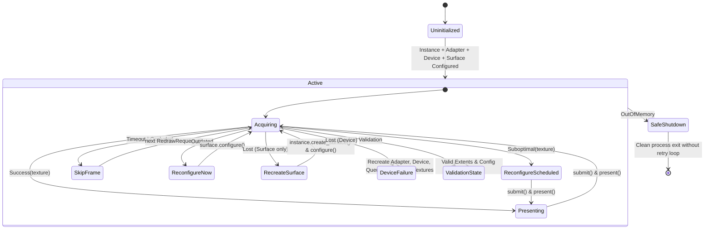

# Native Liquid Glass Design Specification (D2)

**Document ID:** D2
**Path:** `docs/superpowers/specs/2026-10-23-rust-ui-liquid-glass-design.md`
**Status:** Approved (Gate 2 Approved 2026-10-23)
**Parent Requirements:** [`docs/plans/rust-ui-liquid-glass/gate-1-requirements.md`](../../plans/rust-ui-liquid-glass/gate-1-requirements.md)
**Context & Invariants:** [`docs/plans/rust-ui-liquid-glass/context.md`](../../plans/rust-ui-liquid-glass/context.md)
**Research & Audit:** [`docs/plans/rust-ui-liquid-glass/rust-native-liquid-glass-research.md`](../../plans/rust-ui-liquid-glass/rust-native-liquid-glass-research.md)

---

## 1. Executive Summary & Architecture Evaluation

VolumeControl transitions its UI presentation from webview-based rendering (Tauri WebView2 / WebKitGTK / WKWebView) to an owned, single-renderer native Rust crate: `crates/liquid_glass`.

During Phase 2 architecture exploration, three distinct technical architectures were evaluated:

| Option | Architecture Description | Tradeoffs & Risks | Decision |
|---|---|---|---|
| **A. Retained Semantic Scene (Approved)** | `AppState` → diff → layout tree → flat render primitives & material groups → WGPU. Focus, AccessKit, hit testing share stable semantic IDs. | Upfront engineering investment in text/scene infrastructure. Completely eliminates webview overhead, guarantees deterministic caching, clean accessibility tree, accurate hit-testing under animation, and zero webview memory bloat. | **Selected (User Approved)** |
| **B. Immediate Painting** | D2D / Direct3D / WGPU canvas repainted immediately on every frame. | Lower upfront structure, but makes blur caching, IME state machines, complex Settings forms, keyboard focus, and AccessKit tree reconciliation fragile and error-prone. | Rejected |
| **C. Native Platform Controls + Canvas** | Win32 / AppKit / GTK controls embedded over a transparent WGPU glass canvas. | Offloads text/input to OS controls, but violates the one-renderer mandate, causes inconsistent styling/animations across Windows, macOS, and Linux, and creates cross-process airspace/composition bugs. | Rejected |

---

## 2. Real UI Baseline Grounding

All visual proposals and layout specifications directly preserve and evolve the 3 captured real UI states:

1. **Volume Mixer HUD (`mixer.png`)**:
   - Location: `C:\Users\Thanh\AppData\Local\Temp\volume-control-ui-captures\mixer.png`
   - Current Baseline: Compact dark floating card (400×224 logical px), top-level system output rail, search input, per-app audio session rails with interactive sliders, mute buttons, and Vietnamese copy.
   - Native Adaptation: Retained `Panel` glass material with downsampled multi-pass Gaussian blur over app-owned backdrop; slider tracks and thumbs use smooth signed-distance field (SDF) union; semantic hit bounds strictly match un-deformed geometry; Escape closes.

2. **General Settings (`settings_general.png`)**:
   - Location: `C:\Users\Thanh\AppData\Local\Temp\volume-control-ui-captures\settings_general.png`
   - Current Baseline: Resizable window (760×620 design size, min 620×520), sidebar navigation with surface/category list, scrollable form elements, text inputs, dropdown selects, and Reset/Cancel/Save bottom action bar.
   - Native Adaptation: Sidebar uses `Sidebar` material role; main form area uses `Panel` role; text input uses `TextSystem` with Vietnamese IME composition rect tracking; draft state isolated from confirmed host config.

3. **Appearance & Material Settings (`settings_appearance.png`)**:
   - Location: `C:\Users\Thanh\AppData\Local\Temp\volume-control-ui-captures\settings_appearance.png`
   - Current Baseline: Theme picker (`ThemeMode`: Light, Dark, System), Material picker (`MaterialMode`: Auto, Translucent, Opaque), Motion picker (`MotionMode`: Full, Reduced, Disabled), Accent picker (`AccentMode`: System, Blue, Green, Purple, Orange).
   - Native Adaptation: Draft modifications preview live in Settings glass surfaces without persisting to `config.ini` until user clicks Save (`AppAction::ApplyConfig`). Cancel reverts draft to confirmed `AppState`. High contrast and reduced transparency force opaque fallback.

4. **Overlay HUD & Help**:
   - Overlay: Compact 336×88 logical px HUD anchored bottom-right. Windows uses native HUD; Linux uses narrow host layer-shell adapter to anchor overlay without polluting portable renderer crate. Click-through is capability-gated.
   - Help: 520×500 logical px scrollable shortcut reference card rendered natively.

---

## 3. Retained Semantic Scene Architecture (D1)

### 3.1 Ownership and Boundary

- **Host Authority**: `crates/volumectl` remains the single authority for audio hardware, session control, configuration, hotkeys, tray, and persistence (`config.ini`).
- **Renderer Scope**: `crates/liquid_glass` owns scene node allocation, material token resolution, closed-form analytic springs, WGSL shader passes, blur pyramid caching, `TextSystem` shaping/draw, and WGPU swapchain presentation.
- **Contract**:
  - Inbound: `NativeRenderer::publish(&mut self, state: &AppState, tokens: &ThemeTokens, caps: &UiCapabilities)`
  - Outbound: `HostHandle::enqueue(action: AppAction)`
  - The renderer never invokes platform audio APIs or modifies configuration files directly.

### 3.2 Component Flow

```text
Host (audio / config / tray / hotkeys)
  │ confirmed AppState, ThemeTokens, UiCapabilities
  ▼
State Bridge (crates/volumectl/src/ui/)
  │ SceneDiff (dirty node set, changed material roles, text runs)
  ▼
Retained Semantic Scene (crates/liquid_glass) ──► AccessKit Tree (same semantic IDs)
  │ layout pass (recompute changed subtrees)
  │ flatten pass (RenderPrimitive, text glyphs, material groups)
  ▼
Render Graph
  │ App-owned content texture → downsampled blur pyramid (cached by revision)
  │ SDF material passes (by z-order) → Glyphon text runs / icons / focus rings
  ▼
WGPU Surface (Surface::get_current_texture)
  ▲
Winit Input / IME ──► Interaction & Focus Manager ──► Semantic Hit Test ──► AppAction
```

---

## 4. Native Data Flow & Host Contract Extensions (D2)

### 4.1 Host Contract Extensions (Pre-Cutover Prerequisite)

The host contracts in `crates/volumectl/src/ui/model.rs` and `capabilities.rs` must be extended before native surfaces can replace webviews:

1. **Audio Sessions in `AppState`**:
   - Add `pub sessions: Vec<AudioSessionState>` to `AppState`.
   - Host enumerates WASAPI (Windows) sessions and republishes confirmed state when sessions appear, change volume, mute, or terminate.
2. **Session Actions in `AppAction`**:
   - Add `AppAction::SetSessionVolume { id: String, percent: u8 }`.
   - Add `AppAction::ToggleSessionMute { id: String }`.
   - Wire host routing in `crates/volumectl/src/host_core.rs`.
3. **Settings Draft & Commit Lifecycle**:
   - Wire `AppAction::ApplyConfig`, `AppAction::CancelConfig`, `AppAction::ResetConfig` in `host_core`.
   - Add `AppAction::SetAccent(AccentMode)` and `AppAction::SetLanguage(Language)`.
   - Add `pub accent: AccentMode` to `AppState`.
4. **Reduced Transparency Capability**:
   - Add `pub reduced_transparency: bool` to `UiCapabilities`.
   - Platform detection: Windows `SPI_GETCLIENTAREAANIMATION` / DWM registry; macOS `accessibilityDisplayShouldReduceTransparency`; Linux desktop portal.
   - `resolve_material` forces `ResolvedMaterial::Opaque` whenever `caps.high_contrast || caps.reduced_transparency`.

### 4.2 Scene Lifecycle per Frame

1. **Host Publish**: Host invokes `publish(state, tokens, caps)`. State bridge compares previous state revision against new state, producing a minimal `SceneDiff`.
2. **Layout & Diff Apply**: Scene applies diff, updating dirty node bounds, text layout runs, and material role assignments. Clean subtrees are untouched.
3. **Flattening**: Traverses scene in z-order, emitting flat primitives:
   ```rust
   pub struct RenderPrimitive {
       pub id: SemanticId,
       pub bounds: Rect,
       pub material_role: MaterialRole,
       pub z_order: u16,
       pub clip: Option<Rect>,
   }
   ```
4. **Blur Invalidation**: If `content_revision` changed, content is rendered to an offscreen readable texture and downsampled Gaussian blur passes rebuild the pyramid. If unchanged, the existing pyramid texture is reused.
5. **Draw & Present**: SDF material groups shade glass, rim highlight, and tint; `TextSystem` draws text runs; focus rings render on top.
6. **Redraw Control**: Renderer returns `animating: bool`. Host event loop requests a redraw only if `animating == true` or when a new OS/host event arrives. Zero redraws during idle.

---

## 5. Multi-Layer Liquid Glass Optics & Motion System (D3)

### 5.1 Material Role Hierarchy

| MaterialRole | Applied Surfaces & Components | Blur Radius | Tint Opacity | Saturation | Edge & Specular Rim |
|---|---|---|---|---|---|
| **Hud** | Overlay volume HUD, temporary toasts | High (24–32px) | Light (12–18%) | High (180%) | 1.0px specular highlight |
| **Panel** | Mixer window card, Settings content card | Medium (16–20px) | Medium (25–35%) | Medium (150%) | 0.75px subtle edge |
| **Sidebar** | Settings navigation sidebar | Medium (16–20px) | Dense (40–50%) | Low (120%) | 0.5px border separator |
| **Control** | Slider thumbs, segmented pill toggles | Low (8–12px) | Opaque/Dense (60–80%) | Normal (100%) | 1.5px high-contrast rim |
| **Accent** | Volume gauge fill, active selection indicator | None (direct) | Accent Color (100%) | N/A | Crisp boundary |
| **Tooltip** | Hover hints, keyboard badge | Low (8px) | Light (20%) | High (160%) | 0.5px edge |
| **Menu** | System tray popup menu | Medium (16px) | Light (20%) | High (170%) | 1.0px edge |

### 5.2 Accessibility Fallback Chain

```text
Appearance Inputs (theme, contrast, transparency, motion)
  │
  ├─► Is high_contrast == true OR reduced_transparency == true?
  │     └─► YES: Force All Roles -> Opaque Fallback
  │              Blur = 0, Alpha = 1.0, High-contrast 2px borders, WCAG AA >= 4.5:1
  │     └─► NO: Continue to Standard Resolution
  │
  ├─► Is reduce_motion == true?
  │     └─► YES: Disable fluid stretch, trailing, ripple, and bounce.
  │              Transitions become immediate or simple 120ms linear alpha fade.
  │     └─► NO: Enable analytic closed-form springs and interaction ripples.
  │
  └─► Resolve Role + Scheme (Light/Dark) -> MaterialTokens (WGSL Uniforms)
```

### 5.3 Bounded Analytic Motion

- **Closed-Form Spring**:
  $$x(t) = A \cdot e^{-\zeta \omega_n t} \cos(\omega_d t + \phi) + x_{\text{target}}$$
  - Evaluated at arbitrary timestamp $t$; requires no per-frame numerical integration.
  - Retargeting preserves instantaneous position and velocity, ensuring continuous, interruptible movement.
  - Settling condition: when $|x(t) - x_{\text{target}}| < \epsilon$ and $|v(t)| < \epsilon_v$, motion is declared settled and redraw loop halts.
- **SDF Union for Control Merging**:
  - Slider track and thumb distance fields undergo smooth polynomial union:
    $$d_{\text{smooth}}(a, b, k) = \min(a, b) - \frac{\max(k - |a - b|, 0)^2}{4k}$$
  - Creates organic fluid blending between interacting elements while preserving exact semantic hit boxes.
  - **Invariant**: Hit testing always evaluates against the un-deformed semantic rectangle.

---

## 6. GPU Error Recovery & Cross-Platform Engine (D4)

### 6.1 WGPU 30.0.1 Surface Lifecycle & Recovery State Machine



### 6.2 Platform Backends and Specifics

- **Windows (x86_64)**:
  - Backend Policy: Try DX12 instance first; fallback to Vulkan if DX12 adapter is unavailable.
  - DXC Shader Compiler: Pin `static-dxc` feature to embed compiler statically, eliminating runtime `dxcompiler.dll` installation dependency.
- **macOS (Apple Silicon & Intel)**:
  - Backend Policy: Metal backend exclusively.
  - Retina: Handle native scale factors (2.0×) and dynamic display migration cleanly.
- **Linux (x86_64)**:
  - Backend Policy: Vulkan backend.
  - Layer-Shell Adapter: A narrow platform-host adapter in `crates/volumectl/src/ui/platform/linux/` configures Wayland layer-shell anchors (bottom-right) and `Layer::Overlay` stacking. The portable `crates/liquid_glass` renderer crate contains zero Wayland protocol code.
  - Wayland HUD Interactivity: Overlay window remains interactive when compositor rejects input-shape pass-through.

---

## 7. Verification and Traceability Matrix

Every requirement and non-functional metric from Gate 1 is addressed by D1–D4:

| Requirement | Design Section | Verification Method |
|---|---|---|
| **R1 (Host Authority)** | §3.1, §4.1 | Host action dispatch unit tests; state mutation readback assertions. |
| **R2 (Replace WebViews)** | §1, §3.1 | Build verification: clean release artifact without webview/Tauri frontend deps. |
| **R3 (Config Draft/Commit)** | §2, §4.1 | Settings draft unit tests: draft change != config.ini change; Save commits. |
| **R4 (Surface Geometry)** | §2, §6.2 | Visual snapshot test vs `mixer.png`, `settings_general.png`, `settings_appearance.png`. |
| **R5 (EN/VI & Native Text)** | §3.2, §4.1 | `TextSystem` test: Vietnamese diacritics shaping, fallback fonts, IME caret tracking. |
| **R6 (Accessibility Tree)** | §3.1, §5.2 | AccessKit inspection via Accessibility Insights (Win), VoiceOver (macOS), Accerciser (Linux). |
| **R7 (Appearance Resolution)** | §5.1, §5.2 | Capability matrix unit tests: high contrast / reduced transparency -> opaque fallback. |
| **R8 (Glass Optics)** | §5.1 | Offscreen blur pyramid and WGSL material render test against baseline colors. |
| **R9 (Bounded Motion)** | §5.3 | Analytic spring unit tests: zero drift, settling termination, reduced motion bypass. |
| **R10 (Platform Backends)** | §6.2 | Target integration builds: DX12/Vulkan (Win), Metal (macOS), Vulkan (Linux). |
| **N1 (Single Renderer)** | §1, §3.1 | Cargo workspace dependency tree audit (no React, Tauri webview, egui, Iced). |
| **N2 (MSRV & Dependencies)** | §1, §6.2 | `cargo check` under Rust 1.92 with `wgpu 30.0.1` and `glyphon 0.12`. |
| **N3 (Allocation Stability)** | §4.2, §5.3 | Frame profiler: 0 heap allocations during steady-state animation loop. |
| **N4 (Surface Recovery)** | §6.1 | Injectable WGPU error test harness covering all 7 acquisition statuses. |
| **N5 (A11y Priority)** | §5.2 | Automated contrast ratio check (WCAG AA >= 4.5:1) in all fallback modes. |
| **N6 (No Release Shims)** | §1, §3.1 | Post-cutover source audit verifying complete deletion of webview bridges. |
